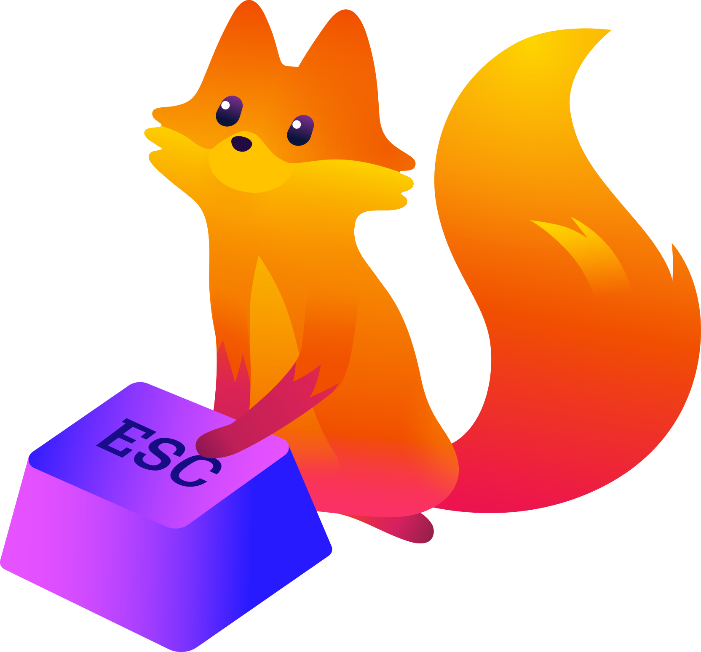

### Hey there 👋

I'm a backend software developer and tinkerer working at [Stackable][stackable] working on rustifying
the Kubernetes/container ecosystem with [operator-rs] and tooling. In my spare time, I do more of the
things I mentioned above and a few other bits and pieces.

[operator-rs]: https://github.com/stackabletech/operator-rs
[stackable]: https://github.com/stackabletech

#### 🔥 Check out what I'm working on

- [stackabletech/docker-images](https://github.com/stackabletech/docker-images) - Product images for the Stackable Data Platform (1 day ago)
- [stackabletech/trino-operator](https://github.com/stackabletech/trino-operator) - Kubernetes operator for Trino. Deploy and run Trino coordinators and workers with the Stackable Data Platform (SDP). (3 days ago)
- [stackabletech/commons-operator](https://github.com/stackabletech/commons-operator) - Kubernetes operator for common resources shared across the Stackable Data Platform (SDP). (3 days ago)
- [stackabletech/superset-operator](https://github.com/stackabletech/superset-operator) - Kubernetes operator for Apache Superset. Deploy and run Superset with the Stackable Data Platform (SDP). (3 days ago)
- [stackabletech/zookeeper-operator](https://github.com/stackabletech/zookeeper-operator) - Kubernetes operator for Apache ZooKeeper. Deploy and run ZooKeeper ensembles with the Stackable Data Platform (SDP). (3 days ago)

#### 🧪 Latest PRs

- [feat(boil): Auto-detect target platform](https://github.com/stackabletech/docker-images/pull/1762) on [stackabletech/docker-images](https://github.com/stackabletech/docker-images) (1 day ago)
- [chore: Release 1.5.3](https://github.com/stackabletech/stackablectl/pull/479) on [stackabletech/stackablectl](https://github.com/stackabletech/stackablectl) (1 week ago)
- [fix: Use 26.11.0 for OpenSearch](https://github.com/stackabletech/demos/pull/492) on [stackabletech/demos](https://github.com/stackabletech/demos) (1 week ago)
- [chore: Add 26.11 release](https://github.com/stackabletech/release/pull/43) on [stackabletech/release](https://github.com/stackabletech/release) (1 week ago)
- [chore: Update changelog from release 26.11.0](https://github.com/stackabletech/cockpit/pull/493) on [stackabletech/cockpit](https://github.com/stackabletech/cockpit) (1 week ago)

#### 📜 My recent blog posts - [Source](https://github.com/Techassi/page)

- [Low screen resolution after reboot](https://techassi.dev/posts/low-screen-resolution-after-reboot/) (7 months ago)
- [VLANs - The easy way](https://techassi.dev/posts/vlans-the-easy-way/) (4 years ago)

#### 📫 How to reach me

- Mastodon: [https://chaos.social/@techassi](https://chaos.social/@techassi)
- E-Mail: git@techassi.dev
